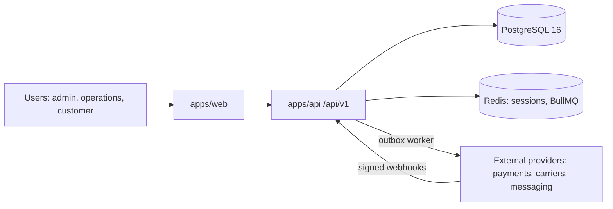

# Architecture

## C4 · Context

## Containers (Lightsail)
- `app` container (public, HTTPS): serves web build and API.
- `worker` container (private): outbox dispatcher and BullMQ jobs.
- `redis` container (private, `redis.service.local:6379`).
- Managed PostgreSQL (private). Object Storage bucket per project.

## Key decisions
See `docs/adr/`. 0001 stack · 0002 transactional outbox · 0003 integrations via adapters.

## Main flows
1. Request → zod validation → service (transaction) → repository → audit log → outbox event.
2. Worker reads outbox → calls provider adapter with retries → marks delivered.
3. Provider webhook → signature check → dedupe by event id → job → service. (Roadmap: StripeGateway.verifyWebhook and the WebhookEvent table exist; the /api/v1/webhooks/<provider> route that uses them is not built yet.)
