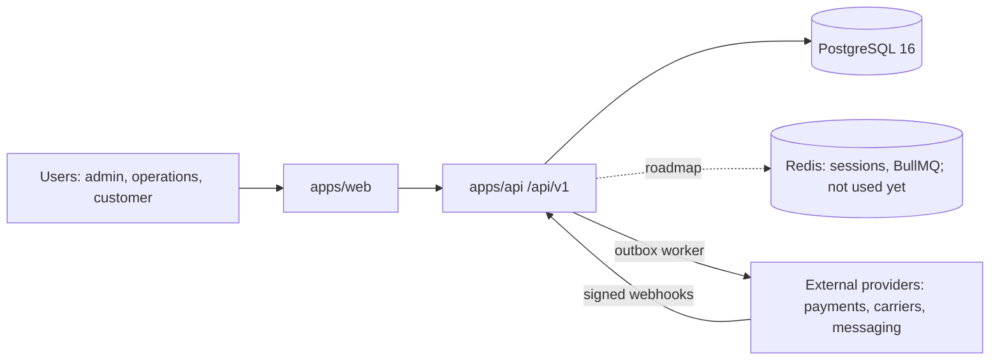

# Architecture

## C4 · Context

## Containers (Lightsail)
- `app` container (public, HTTPS): serves web build and API.
- `worker` container (private): outbox dispatcher (polls the database). BullMQ jobs: roadmap.
- `redis` container (private, `redis.service.local:6379`): provisioned for the roadmap (sessions, BullMQ); no code uses it yet.
- Managed PostgreSQL (private). Object Storage bucket per project.

## Key decisions
See `docs/adr/`. 0001 stack · 0002 transactional outbox · 0003 integrations via adapters.

## Main flows
1. Request → session check (role, tenant) → zod validation → service (transaction) → repository → audit log → outbox event.
2. Worker reads outbox → calls provider adapter with retries → marks delivered.
3. Provider webhook (`POST /api/v1/webhooks/payments`) → signature check on the raw body → dedupe by provider event id (`WebhookEvent`) → optimistic state transition + audit + outbox in one transaction → 200.
