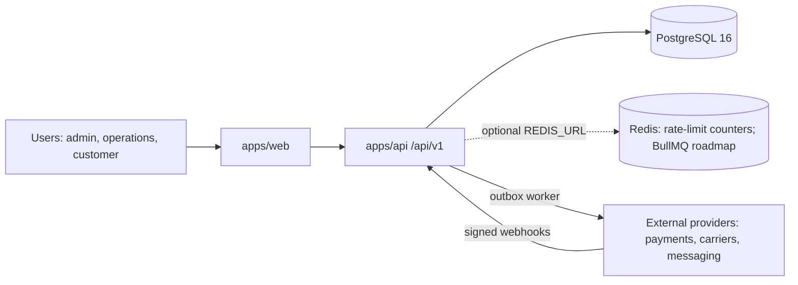

# Architecture

## C4 · Context

## Containers (Lightsail)
- `app` container (public, HTTPS): serves web build and API.
- `worker` container (private): outbox dispatcher (polls the database). BullMQ jobs: roadmap.
- `redis` container (private): used for rate-limit counters when the API has `REDIS_URL` set (required before running more than one API instance); BullMQ is roadmap. The address the app container uses to reach it must be confirmed on the first deploy.
- Managed PostgreSQL (private). Object Storage bucket per project.

## Key decisions
See `docs/adr/`. 0001 stack · 0002 transactional outbox · 0003 integrations via adapters.

## Main flows
1. Request -> session check (signature, expiry, then the user re-read by id: session version, role and tenant must match) -> role and tenant guard -> zod validation -> service (transaction) -> audit log -> outbox event. Repositories cover users, orders, idempotency and audit; order creation and the webhook still write some rows through Prisma inside their transaction (roadmap: move them behind repositories).
2. Checkout (`POST /api/v1/orders/:id/checkout`) -> Idempotency-Key check (scoped by tenant, bound to the request hash) -> provider payment intent with idempotency key `checkout:<orderId>` -> one transaction: transition to `pending_payment` (optimistic), intent id, audit, idempotency record -> response with the client secret (never stored).
3. Worker claims outbox rows (FOR UPDATE SKIP LOCKED + lease) -> handler for the event type -> provider adapter -> delivered; failures back off exponentially; after 8 attempts the row is dead-lettered and an `outbox_dead_letter` error is logged.
4. Provider webhook (`POST /api/v1/webhooks/payments`) -> signature check on the raw body -> one transaction: event record (`WebhookEvent`, unique provider id), checks (intent status `succeeded`, amount received, amount, currency, intent id), optimistic transition to `paid`, audit and outbox; a failure rolls everything back so the provider retry is processed; a duplicate is acknowledged without effects -> 200.
