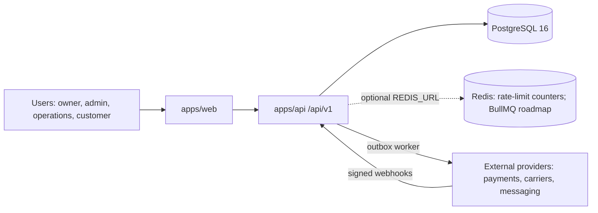

# Architecture

## C4 · Context

## Containers (Lightsail)
- `app` container (public, HTTPS): serves web build and API.
- `worker` container (private): outbox dispatcher (polls the database). BullMQ jobs: roadmap.
- `redis` container (private): used for rate-limit counters when the API has `REDIS_URL` set (required before running more than one API instance); BullMQ is roadmap. The address the app container uses to reach it must be confirmed on the first deploy.
- Managed PostgreSQL (private). Object Storage bucket per project (private Lightsail bucket, S3 API, bucket access key; uploads by pre-signed PUT under `tenants/{tenantId}/...`).
- Sentry (optional, `SENTRY_DSN`): errors and sampled traces from `app`, `worker` and the browser.

## Key decisions
See `docs/adr/`. 0001 stack · 0002 transactional outbox · 0003 integrations via adapters · 0004 TOTP 2FA and customer self-service · 0005 per-integration modes and the ALLOW_LIVE gate.

## Main flows
1. Request -> session check (signature, expiry, then the user re-read by id: session version, role and tenant must match) -> role and tenant guard -> zod validation -> service (transaction) -> audit log -> outbox event. Repositories cover users, orders, idempotency and audit; order creation and the webhook still write some rows through Prisma inside their transaction (roadmap: move them behind repositories).
2. Checkout (`POST /api/v1/orders/:id/checkout` for staff, `POST /api/v1/me/orders/:id/checkout` for the owning customer; one service, `startCheckout`) -> Idempotency-Key check (scoped by tenant, and by customer on `/me`, bound to the request hash) -> order read by tenant (staff) or by tenant AND owner (customer: another customer's order is a 404) -> provider payment intent with idempotency key `checkout:<orderId>` -> one transaction: transition to `pending_payment` (optimistic), intent id, audit, idempotency record -> response with the client secret (never stored).
3. Worker claims outbox rows (FOR UPDATE SKIP LOCKED + lease) -> handler for the event type -> provider adapter -> delivered; failures back off exponentially; after 8 attempts the row is dead-lettered and an `outbox_dead_letter` error is logged.
4. Provider webhook (`POST /api/v1/webhooks/payments`) -> signature check on the raw body -> one transaction: event record (`WebhookEvent`, unique provider id), checks (intent status `succeeded`, amount received, amount, currency, intent id), optimistic transition to `paid`, audit and outbox; a failure rolls everything back so the provider retry is processed; a duplicate is acknowledged without effects -> 200.
5. Customer self-service order (`POST /api/v1/me/orders`) -> Idempotency-Key check on the body the customer sent (SKUs and quantities) -> prices and currency from the tenant's active `Product` rows -> the same transaction as staff orders: order owned by the caller (`customerUserId`), items, audit, outbox `order.created`, idempotency record.
6. Login with 2FA -> password check (identical answer for a wrong password with or without 2FA) -> `{ mfaRequired: true }` and a 5-minute purpose-signed `mfa` cookie -> `POST /api/v1/auth/login/mfa` with a TOTP code (single-use step) or a recovery code (single-use) -> session cookie. Owners without 2FA under `REQUIRE_OWNER_2FA=true` get a session limited to enrollment (403 `MFA_ENROLLMENT_REQUIRED` elsewhere).
7. Outbox notification -> `MessagingProvider` (fake, or Resend when `MESSAGING_MODE` is sandbox/live; sandbox delivers only to the test inbox and `MESSAGING_ALLOW_LIST`) with idempotency key `outbox:<eventId>` -> on a non-retryable error the event is dead-lettered at once; otherwise the worker backs off.
8. Boot -> env schema (API and worker) resolves `PAYMENTS_MODE`, `MESSAGING_MODE`, `CARRIER_MODE`, `STORAGE_MODE` (each defaults to `INTEGRATIONS_MODE`) and validates providers and secrets per mode, `live` only with `ALLOW_LIVE=true` on `APP_ENV=production` -> any problem exits the process before it listens (ADR 0005).
9. Carrier quote -> `CarrierRates` (fake, or OES): one 8 s budget, retries with jitter on 5xx/429 only, circuit breaker (5 failures, 30 s).
